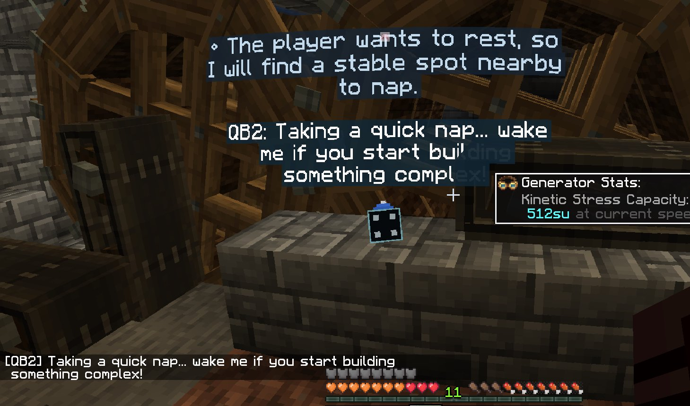
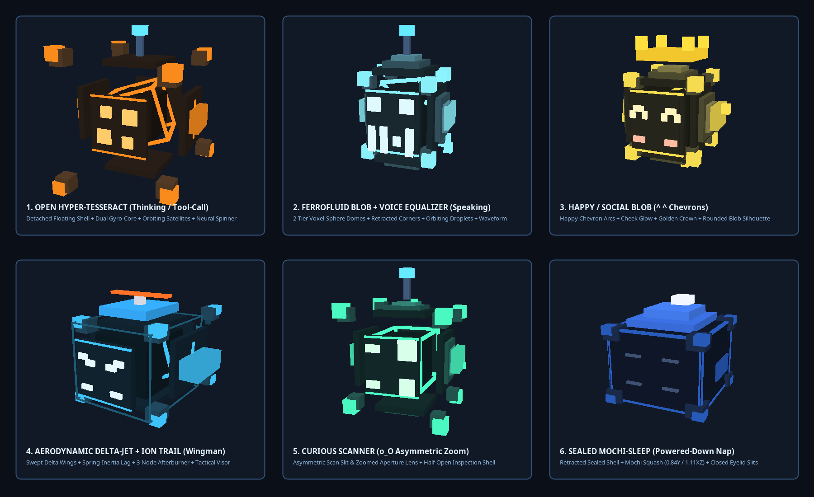
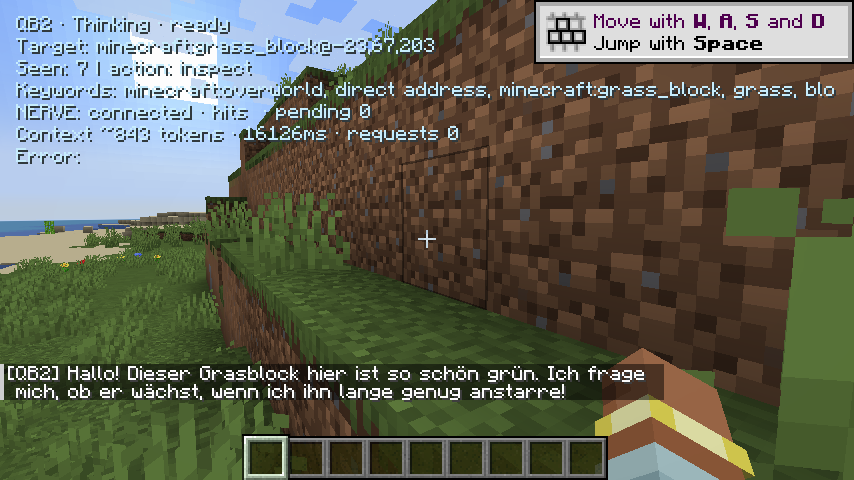
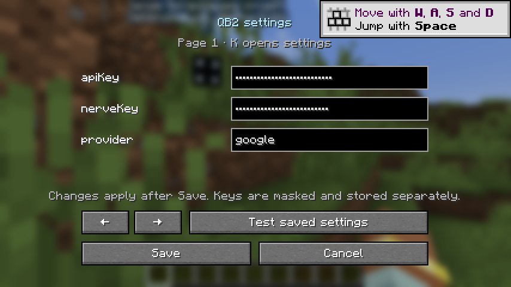
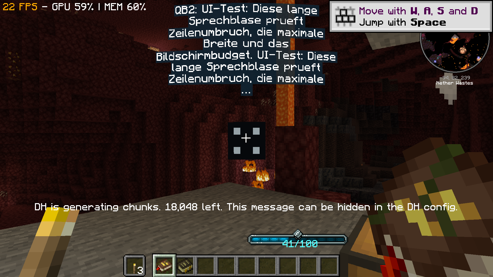

# Cubey Companion (`qb2`)

**Ein lebendiger, rein clientseitiger KI-Begleiter für Minecraft Java 1.21.1 (NeoForge 21.1.x / Java 21).**

Cubey ist kein bloßes Chatfenster, sondern ein physisch in der Spielwelt präsenter **Neo-Fluid Morphing-Begleiter (~0,25 Block)** mit einem **aufgebrochenen Magnet-Schalen-Kern (6 schwebende Split-Shell-Platten + gegenläufig rotierender Dual-Gyro-Plasmakern)**, **8 abgelösten Orbital-Eck-Shards**, **7-stufiger Neo-Augenmimik (`^ ^`, `o_O`, `\ /`, Neural-Spinner, Voice-Equalizer)** und **7 situativen 3D-Hüten**. Er kann seine feste Würfelform dynamisch aufbrechen – vom **offenen Hyper-Tesseract** beim Nachdenken über einen **organisch pulsierenden Ferrofluid-Blob** beim Sprechen/Tanzen bis zum **aerodynamischen Delta-Jet mit 3-teiligem Ionen-Schweif** im Schnellflug. Er beobachtet die Welt aus seiner eigenen Perspektive, merkt sich den Inhalt geöffneter Kisten samt 3D-Koordinaten, führt dich auf Wunsch zu gesuchten Items oder deinem letzten Todesort zurück, erklärt komplexe Modpack-Anlagen (z. B. *Create*, *Mekanism*, *AE2*) per Read-Only Tool-Calling und reagiert mit über **28 lokalen Mikro- & Social-Verhaltensweisen** auf deine Umgebung.





| Live-Antwort im Spiel | Ingame-Einstellungen (`K`) | Katalog- & Block-Inspektion |
|---|---|---|
|  |  |  |

---

## Highlights

- **100 % Clientseitig & optionaler Multiplayer-Cubey-Sync (`v0.9.3`):** Funktioniert auf jedem Vanilla- oder Mod-Server ohne Server-Pflicht. Ist `qb2` optional auch auf dem Server installiert (`PayloadRegistrar.optional()`), sehen Spieler im Umkreis von 48 Blöcken gegenseitig ihre Cubeys samt 3D-Hüten, Status-Leuchten, Schlafpose und optional geteilten Sprechblasen – gehärtet mit Anti-Spoofing-Radiusprüfung (24m), Enum-Whitelisting und 80ms Rate-Limiter. Zusätzlich gibt es **8 seltene soziale Choreografien** (`SocialChoreography`: Doppel-Helix-Walzer mit Resonanz-Lichtbogen, synchroner Barrel-Flip, Antennen-Boop, Hut-Spiegelung zwischen Cubeys sowie Schulter-Sitzen, Peekaboo-Scan, Halo-Orbit und Friedens-Crouch-Verbeugung gegenüber anderen Spielern).
- **Lebendige Physik & Präsenz (0 LLM-Tokens):**
  - **Kein Teleportieren / Rubber-Banding:** Cubey zeichnet deinen gelaufenen Weg als Breadcrumb-Spur (`PlayerTrail`) auf und fliegt dir weich durch Türen und Gänge hinterher (`VoxelPathfinder` 3D-A\*).
  - **Dynamischer Wingman-Modus:** Erkennt automatisch, wenn du mit der Elytra fliegst, im Boot/Minecart sitzt oder ein Flugzeug aus *Immersive Aircraft* steuerst – passt seine Geschwindigkeit bis 2,4 Blöcke/Tick an und legt sich dynamisch mit in deine Kurven.
  - **Vantage-Perching & Powered-Down-Schlaf:** Setzt sich bei Ruhe bevorzugt auf erhöhte **Blockkanten** (mit Blick in den Raum), in gemütliche **Mauer-Nischen** oder ans Fußende deines Betts. Im Schlaf schließen sich seine 4 Sensor-Augen zu schmalen Lidern, die 8 Eck-Kappen ziehen sich zusammen und atmen langsam im 4-Sekunden-Takt.
  - **20+ situative Reaktionen & 7 3D-Hüte:** Reagiert lokal auf Augenkontakt (Nicken), Schleichen (`Shift`), Kisten-/Werkbank-Öffnen (neugierig über die Schulter schauen), Regen, Dunkelheit, nahe Monster, Item-Drops, Öfen/Lagerfeuer, Angeln, Bogen-Zielen, Abgründe, Level-Ups, Musik (Jukebox-Disco), reitet auf Haustieren/Tieren und wechselt passend zur Situation seinen 3D-Hut (`miner`, `rain`, `sleep`, `crown`, `propeller`, `chef`, `antenna`).
- **Sparsames Read-Only Tool-Calling & Attention-Aliase:**
  - Statt den gesamten Zustand in jeden Prompt zu werfen, nutzt Cubey kurze präfix-freie Attention-Aliase (`b1: Mechanical Drill (att:9, 2m)`) – das spart **~60 % Input-Tokens**.
  - Über 5 Read-Only-Tools (`inspect_details`, `scan_area`, `check_inventory`, `search_memory`, `lookup_recipe`) lädt das Modell Details zu Nachbarmaschinen, Inventar oder Rezepten nur dann nach, wenn deine Frage sie wirklich braucht.
  - **Begrenzter Priority-Action-Stack (`ActionQueue`):** Mehrstufige Aktionspläne werden nach Priorität (`0–10`) und FIFO abgearbeitet.
- **Dual-Memory (Standalone-JAR + optionale Rust/Bun NERVE & `SpatialGrid2D` Bridge):**
  - **Out-of-the-Box Standalone:** Funktioniert sofort nach dem Kopieren der `.jar` mit dem eingebauten Java-Speicher (`LocalFallbackMemory`) für Erinnerungen und 3D-Umgebungssuche.
  - **High-Performance NERVE + `SpatialGrid2D` Bridge (optional):** Indexiert automatisch alle geladenen Blöcke, Items, Entities und Rezepte (getestet mit **164.366 Craftoria-Fakten**) sowie räumliche Nachbarschaften in unter 30 µs.

---

## 1. Installation der Mod

### Fertige JAR bauen & installieren

Voraussetzung zum Bauen: **Java 21**.

```bash
./gradlew clean build
./scripts/install.sh /pfad/zu/deiner/minecraft-instanz
```

Oder kopiere `build/libs/qb2-1.0.0-client.jar` direkt in den `mods/`-Ordner deiner Minecraft-1.21.1-NeoForge-Instanz (z. B. in Prism Launcher oder der Modrinth App). Für optionale Multiplayer-Server gibt es zusätzlich die federleichte, reine Server-Sync-JAR `build/libs/qb2-1.0.0-server.jar` (nur für Dedicated Server – Clients bitte immer `*-client.jar` verwenden!).

---

## 2. KI-Modell verbinden (Lokal im VRAM, Google Gemma/Gemini oder andere AI)

Drücke im Spiel **`K`** (oder *Mods → QB2 Companion → Config*), um die Einstellungen zu öffnen. Über den Button **`Preset`** kannst du mit einem Klick zwischen den drei Standard-Setups wechseln:

### Option A: 100 % Lokal im eigenen Grafikkarten-VRAM (Ollama – kostenlos, 0 Rate-Limits)

Ideal, wenn du ~1–3 GB freien VRAM auf deiner GPU hast (z. B. `gemma3:1b` mit nur ~815 MB VRAM oder `gemma3:4b` mit ~3,1 GB VRAM):

1. **[Ollama](https://ollama.com/) installieren und starten:**
   ```bash
   ollama serve &
   ollama pull gemma3:1b
   # Alternativ für stärkere GPUs (ab 6-8 GB VRAM):
   # ollama pull gemma3:4b
   ```
2. **In Minecraft (`K` drücken):**
   - Klicke auf **`Preset`**, bis **`100% Local Ollama gemma3:1b in VRAM`** angezeigt wird (oder setze manuell: `provider = openai`, `endpoint = http://127.0.0.1:11434/v1`, `model = gemma3:1b`).
   - Klicke auf **`Speichern`**. Es wird kein echter API-Key benötigt (`ollama` wird automatisch eingetragen).

### Option B: Google Gemini / Gemma 4 Cloud API (+ lokales 1B-VRAM-Fallback)

Nutzt die großen **Gemma-4-Modelle** (`gemma-4-26b-a4b-it` & `gemma-4-31b-it` mit 14.400 Requests/Tag im Google AI Studio) und schaltet bei kurzen Rate-Limits (`429`) oder Überlastung (`503`) nahtlos in Millisekunden weiter – inklusive optionalem Fallback auf dein lokales Ollama-Modell:

1. Erstelle einen API-Key im [Google AI Studio](https://aistudio.google.com/).
2. **In Minecraft (`K` drücken):**
   - Trage deinen Schlüssel in das maskierte Feld **`apiKey`** ein (wird getrennt in `config/qb2-secrets.json` mit `0600`-Rechten gespeichert).
   - Klicke auf **`Preset`** für **`Google Gemma 4 + Local 1B VRAM Fallback`**:
     - `provider`: `google`
     - `endpoint`: `https://generativelanguage.googleapis.com/v1beta`
     - `model`: `gemma-4-26b-a4b-it`
     - `modelChain`: `gemma-4-26b-a4b-it,gemma-4-31b-it,gemini-2.5-flash-lite`
     - `ambientModel`: `gemma-4-26b-a4b-it`
     - `fallbackProvider`: `openai`
     - `fallbackEndpoint`: `http://127.0.0.1:11434/v1`
     - `fallbackModel`: `gemma3:1b`
   - Klicke auf **`Speichern`**.

### Option C: Andere OpenAI-kompatible Anbieter (LM Studio, llama.cpp, OpenRouter, vLLM)

Jeder Server mit einem `/v1/chat/completions`-Endpunkt wird unterstützt:
- `provider`: `openai`
- `endpoint`: z. B. `http://127.0.0.1:1234/v1` (LM Studio), `http://127.0.0.1:8080/v1` (`llama-server`) oder `https://openrouter.ai/api/v1`
- `model` / `modelChain`: gewünschte Modell-ID(s)
- `apiKey`: dein API-Key (bzw. beliebiger Platzhalter bei lokalen Servern)

*(Hinweis: Lokale HTTP-Verbindungen sind aus Sicherheitsgründen nur auf Loopback-Adressen `127.0.0.1` / `localhost` erlaubt; entfernte Server erfordern `https://`.)*

---

## 3. Bedienung & Interaktion im Spiel

### Direkte Maus-Interaktion mit Cubey
- **Linksklick (LMB) auf Cubey gedrückt halten:** Cubey im Gravitationsgriff **aufheben & umhertragen** (einfach loslassen zum sanften Absetzen).
- **Während LMB gedrückt ist → Rechtsklick (RMB) halten & loslassen:** **Wurf aufladen** (mit Live-HUD-Ladebalken direkt unter dem Fadenkreuz + ansteigendem Kristall-Ton) & **Cubey werfen** – je länger du RMB hältst (bis 2 Sekunden), desto weiter fliegt er mit niedlichem *„Weeeee!“*-Sound im aerodynamischen Delta-Modus und prallt bis zu 3× elastisch an Blöcken ab (`*boing*`)!
- **Quick-Question-Radialmenü (`G` gedrückt halten oder Cubey sanft auf einen Block setzen):** Öffnet ein Sci-Fi-Radialmenü mit 6 Direktfragen (*Was ist das?*, *Wie baut man das?*, *Ist das nützlich?*, *Aufbau erklären*, *Erzähl nen Witz!*, *Ort merken*). Über `K → Visuals` lassen sich Cubeys **niedliche Custom-Sounds** jederzeit ein-/ausschalten und per **Lautstärke-Slider (`0 %–100 %`)** regeln.
- **Lokales Push-to-Talk (`V` gedrückt halten – `whisper.cpp` Base auf CPU, 0 MB VRAM):** Einfach **`V`** halten, normal mit Cubey sprechen (Live-Pegelanzeige im HUD) und loslassen – die lokale `qb2-bridge` transkribiert deine Sprache über `whisper.cpp` (`ggml-base-q5_1.bin`, ~190 MB RAM, 0 MB VRAM) direkt an Cubey!
- **Rechtsklick mit leerer Hand auf Cubey:** Streicheln / Anstupsen (`♥`-Blase, fröhlicher Spin & Klang).
- **Rechtsklick mit einem Item in der Hand auf Cubey:** *„Was halte ich hier?“* – Cubey untersucht das Item in deiner Hand, schlägt im Rezept-Katalog nach und erklärt dir Funktion und Verwendung.
- **`Shift + Rechtsklick` auf Cubey:** Hinsetzen (Napping) / Aufwecken direkt umschalten.

### Chat & 15-Sekunden-Gesprächsfenster
- Sprich Cubey im Chat mit **`@qb <Nachricht>`** oder **`@cube <Nachricht>`** an (z. B. `@qb Was macht diese Create-Maschine?` oder `@qb Wo hab ich mein Redstone hingelegt?`).
- **Nachfrage-Fenster:** Nach einer direkten Antwort bleibt das Gespräch **15 Sekunden lang offen** – im Singleplayer (oder bei Fragen mit `?` am Ende) kannst du direkt ohne erneutes `@qb` nachhaken.

### Client-Befehle (`/qb ...`) & Hotkeys
Alle `/qb`-Befehle laufen rein lokal auf deinem Client:
- `/qb status` – Zeigt Zustand, aktives Modell, Backoff-Status, NERVE-Verbindung und Katalog-Fortschritt.
- `/qb find <item>` – **Guide-Modus:** Sucht in den gespeicherten Kisten-Erinnerungen nach `<item>` und lässt Cubey ~5 Blöcke vor dir her zur richtigen Kiste fliegen und sie mit seinem Lichtstrahl markieren.
- `/qb death` – **Todes-Guide:** Führt dich nach einem Respawn direkt zurück zu deinem letzten Todesort.
- `/qb look` (oder belegbarer Hotkey *QB2 Schau mal hier*) – Fokussiert den Block/die Maschine in deinem Fadenkreuz, scannt das 5×4×5-Maschinen-Cluster darum herum und erklärt den Aufbau.
- `/qb come` (oder Hotkey *QB2 Herrufen*) – Ruft Cubey an deine Seite zurück.
- `/qb sit` / `/qb nap` & `/qb wake` – Lässt Cubey auf einer nahen Blockkante oder Wandnische dösen bzw. weckt ihn auf.
- `/qb hat <auto|none|crown|miner|rain|sleep|propeller|chef|antenna>` – Wechselt Cubeys 3D-Hut (oder lässt ihn auf `auto` situativ wechseln).
- `/qb flip` – Lässt Cubey eine 360°-Barrel-Roll fliegen.
- `/qb search <begriff>` – Durchsucht das Welt-Gedächtnis direkt im Chat.
- `/qb pause` / `/qb resume` – Pausiert oder startet Cubey.

### Was bedeuten Cubeys Kantenfarben?
- **Blau:** Ruhiger Begleit-Modus (Idle / Exploring)
- **Tiefes Indigo + geschlossene Lider + langsame Eck-Atmung:** Powered-Down / Napping
- **Orange + ausfahrende Eck-Kappen:** Denkt gerade nach / führt Tool-Calls aus (`Thinking`)
- **Hell Cyan-Weiß:** Spricht gerade oder führt dich im Guide-Modus zu einem Ziel
- **Gold-Türkis / Regenbogen / Violett:** Erz entdeckt, Level-Up, Jukebox-Musik oder Portal-Resonanz
- **Rötlich:** Kurzes visuelles Signal bei einem fehlgeschlagenen API-Aufruf (statt Fehler-Spam im Chat)

---

## 4. Optionale NERVE + `SpatialGrid2D` High-Performance Bridge

Für den normalen Gebrauch reicht die Standalone-JAR völlig aus. Wer zusätzlich die native Rust/Bun-Engine (**NERVE** für 160.000+ Modpack-Rezepte + **`SpatialGrid2D`** für Sub-Mikrosekunden-3D-Nachbarschaftssuche) nutzen möchte:

```bash
# Startet die Loopback-Bridge auf 127.0.0.1:17842 und legt ~/.config/qb2/nerve-token (0600) an:
./scripts/start-bridge.sh
```

Trage anschließend den Inhalt aus `~/.config/qb2/nerve-token` in den Ingame-Einstellungen (`K`) unter `nerveKey` ein. Unter `scripts/qb2-bridge.service` liegt zudem eine fertige `systemd --user`-Unit bereit.

---

## 5. Wie der Mod funktioniert & Erweiterungsmöglichkeiten

```text
Minecraft Client Tick (20 Hz)
 ├── SituationalBehavior (20+ lokale Reaktionen, 0 LLM-Tokens)
 ├── Motion + PlayerTrail + VoxelPathfinder (weiches Nachfliegen, Wingman, 3D-A*)
 ├── ContainerMemory + SessionSummarizer (deduplizierte Kisten- & Sitzungs-Episoden)
 └── InferenceSnapshot (präfix-freie b1..b8 Attention-Aliase + immutable ToolSnapshot)
       │
       ▼  (Hintergrund-Worker in Mind.java – berührt niemals live Minecraft-Objekte)
 ┌─────────────────────────────────────────────────────────────────────────┐
 │ 1. Paralleles Retrieval: NERVE / LocalFallbackMemory + Spatial (/nearby)│
 │ 2. Kompaktes Kontext-Budgeting (ContextBuilder)                         │
 │ 3. Multi-Model Health Router (ModelHealth + ApiLanguageModel)           │
 │ 4. Read-Only Tool-Calling-Loop (max. 2 Runden, bis zu 4 Tools/Turn):    │
 │    inspect_details · scan_area · check_inventory · search_memory ·      │
 │    lookup_recipe                                                        │
 │ 5. JSON-Validierung (Decision) + Priority-Action-Stack (ActionQueue)    │
 └─────────────────────────────────────────────────────────────────────────┘
```

### Wie du Cubey einfach erweitern kannst

1. **Neues Read-Only-Tool für die KI hinzufügen:**
   - Erweitere [ToolSnapshot.java](src/main/java/dev/qb2/cognition/tools/ToolSnapshot.java) um die auf dem Client-Thread erfassten Daten.
   - Registriere den Tool-Namen in `ToolRegistry.TOOLS` und ergänze den `switch`-Zweig in [ToolRegistry.java](src/main/java/dev/qb2/cognition/tools/ToolRegistry.java).
2. **Neue situative Verhaltensweisen oder 3D-Hüte bauen:**
   - Lokale Umgebungs-Checks kommen in [SituationalBehavior.java](src/main/java/dev/qb2/companion/behavior/SituationalBehavior.java).
   - Neue 3D-Voxel-Hüte oder Kanten-/Eck-Animationen lassen sich mit wenigen `box(...)`-Aufrufen direkt in `renderHat(...)` bzw. `renderCornerPods(...)` in [CompanionRenderer.java](src/main/java/dev/qb2/rendering/cube/CompanionRenderer.java) ergänzen (kompatibel mit Iris/Sodium-Shadern).
3. **Neue Bewegungs- oder Sitz-Heuristiken:**
   - Die Bewertung für Kanten, Mauer-Nischen und warme Plätze liegt in `CompanionSession.findPerchSpot(...)` in [CompanionSession.java](src/main/java/dev/qb2/client/lifecycle/CompanionSession.java).

---

## Tests & Verifikation

```bash
./gradlew test                        # 76 JUnit-5-Tests (Core, Network, Pathfinding, Tools, Fallback)
bun test bridge/article-ids.test.ts   # Journal- & ID-Recovery-Tests der Bridge
python3 -m unittest discover -s scripts -p 'test_*.py'
```

Weitere Details: [Architektur](docs/architecture.md) · [Schnittstellen](docs/interfaces.md) · [Gedächtnis](docs/memory.md) · [Konfiguration](docs/configuration.md) · [Testbericht](docs/testing.md) · [Lizenz (MIT)](LICENSE)
